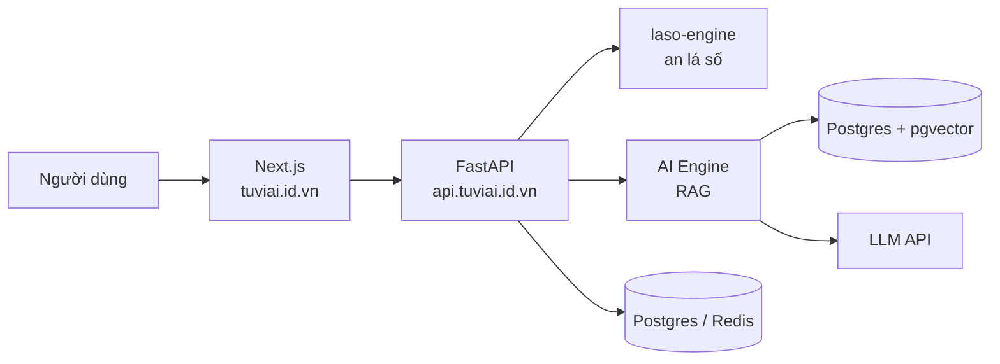

<div align="center">

# 🔮 Tử Vi AI

**Lập lá số Tử Vi Đẩu Số và luận giải bằng AI (RAG + LLM).**

[](https://github.com/phuocs0n/TuVi/actions/workflows/ci.yml)
[](https://github.com/phuocs0n/TuVi/actions/workflows/secret-scan.yml)
[](LICENSE)

[Website](https://tuviai.id.vn) · [API](https://api.tuviai.id.vn/docs) · [Quy trình Git & CI/CD](docs/GIT_WORKFLOW_CICD.md)

<!-- TODO: thêm ảnh/GIF demo: docs/assets/demo.gif -->

</div>

## ✨ Tính năng

- **An lá số tự động**: nhập dương hoặc âm lịch (xử lý tháng nhuận), an Mệnh/Thân, Cục, 14 chính tinh, ~30 phụ tinh, Tứ Hóa, Tuần/Triệt, Đại hạn, vòng Trường Sinh.
- **Luận giải bằng AI**: RAG trên kho tri thức Tử Vi + LLM (Claude/OpenAI).
- **API rõ ràng** (FastAPI, OpenAPI tại `/docs`) và giao diện Next.js.
- **Chất lượng kỹ thuật**: engine thuần Python, test coverage > 95%, type-check strict, CI/CD tự động.

## 🏗️ Kiến trúc



| Tầng | Công nghệ |
|---|---|
| Frontend | Next.js 15, React 19, TypeScript → Vercel |
| Backend | FastAPI, Pydantic, Python 3.12 |
| AI / RAG | Anthropic Claude, pgvector |
| Hạ tầng | Docker, Caddy, GitHub Actions, GHCR |
| Tooling | pnpm, uv, ruff, mypy, pytest, ESLint |

## 🚀 Quick Start

```bash
git clone https://github.com/phuocs0n/TuVi.git && cd TuVi
cp .env.example .env          # điền POSTGRES_PASSWORD, ANTHROPIC_API_KEY, ...
docker compose up --build     # web :3000 · api :8000 · ai-engine :8001
```

Chạy không cần Docker:

```bash
uv sync --all-packages && uv run --directory apps/api uvicorn app.main:app --reload
pnpm install && pnpm dev
```

Thử API:

```bash
curl -X POST localhost:8000/v1/la-so -H 'content-type: application/json' \
  -d '{"ho_ten": "Nguyễn Văn A", "gioi_tinh": "nam", "ngay": 15, "thang": 3, "nam": 1990, "gio": 6}'
```

## 📁 Cấu trúc

```
apps/web            Next.js frontend
apps/api            FastAPI backend
services/ai-engine  RAG + LLM
packages/laso-engine  Engine an lá số (Python thuần)
packages/shared-types Type dùng chung FE/BE
infra/              docker-compose.prod, Caddy
```

## 🧪 Kiểm thử & CI/CD

```bash
ruff check . && ruff format --check .
uv run mypy packages/laso-engine/src
(cd packages/laso-engine && uv run pytest --cov=.)
pnpm -r lint && pnpm -r typecheck
```

Mọi PR chạy lint, type-check, unit test, build Docker và quét secret. Frontend tự deploy lên Vercel khi merge vào `main`; deploy backend (`deploy.yml`) hiện chạy tay cho đến khi có VPS.
Chi tiết: [docs/GIT_WORKFLOW_CICD.md](docs/GIT_WORKFLOW_CICD.md).

## 🗺️ Roadmap

- [x] Engine: đổi dương↔âm lịch, an 12 cung, 14 chính tinh, phụ tinh, Tứ Hóa, Đại hạn
- [x] Giao diện nhập ngày sinh và hiển thị lá số
- [x] Monorepo, CI/CD, quét secret
- [ ] Độ sáng tối (Miếu/Vượng/Đắc/Hãm) của chính tinh, Tiểu hạn, Lưu niên
- [ ] Kho tri thức RAG (pgvector)
- [ ] Đăng nhập và thanh toán

## 🤝 Đóng góp

Xem [CONTRIBUTING.md](CONTRIBUTING.md). Nhánh `develop` nhận PR, commit theo [Conventional Commits](https://www.conventionalcommits.org/).
Báo lỗi bảo mật: [SECURITY.md](SECURITY.md).

## 📄 License

[MIT](LICENSE) © 2026 phuocs0n

> Nội dung luận giải Tử Vi mang tính tham khảo, không thay thế tư vấn chuyên môn.
