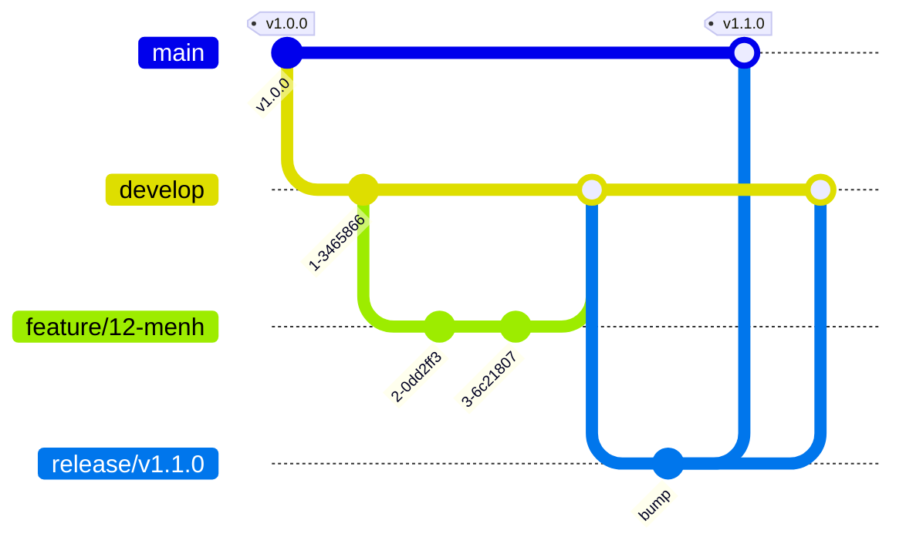
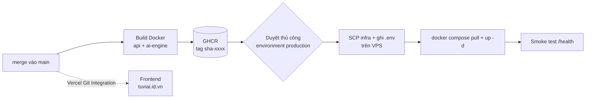

# Git Workflow & CI/CD — Tử Vi AI

Tài liệu quy trình quản lý mã nguồn, kiểm thử và triển khai cho `phuocs0n/TuVi` (domain: **tuviai.id.vn**).

## 1. Cấu trúc Monorepo

Chọn **monorepo** vì: engine an lá số dùng chung cho API và AI Engine, type chia sẻ giữa FE/BE, một PR có thể sửa nhiều tầng, CI dùng `paths-filter` để chỉ chạy phần bị ảnh hưởng.

```
TuVi/
├── apps/
│   ├── web/                  # Next.js 15 (TypeScript) → Vercel
│   └── api/                  # FastAPI → Docker → VPS (api.tuviai.id.vn)
├── services/
│   └── ai-engine/            # RAG + gọi LLM (Claude/OpenAI), chỉ chạy nội bộ
├── packages/
│   ├── laso-engine/          # Engine an lá số (Python thuần, test ≥ 80%)
│   └── shared-types/         # TypeScript types dùng chung
├── infra/                    # docker-compose.prod.yml, Caddyfile
├── scripts/check-domain.sh   # Kiểm tra DNS / HTTPS / SSL
├── docs/
├── .github/                  # workflows, templates, CODEOWNERS, dependabot
├── docker-compose.yml        # môi trường dev
├── pyproject.toml            # uv workspace + cấu hình ruff/mypy
├── package.json, pnpm-workspace.yaml
└── .env.example, .gitignore, .gitleaks.toml, .pre-commit-config.yaml
```

### File cấu hình bắt buộc

| File | Mục đích |
|---|---|
| `.gitignore` | Chặn `.env*`, `node_modules`, `.venv`, khoá, dữ liệu vector |
| `.env.example` | Danh sách biến môi trường, chỉ chứa placeholder |
| `README.md` | Giới thiệu, Quick Start, kiến trúc |
| `docker-compose.yml` | Chạy toàn bộ stack dev bằng một lệnh |
| `.gitleaks.toml`, `.pre-commit-config.yaml` | Quét secret trước khi commit |
| `commitlint.config.js` | Quy chuẩn Conventional Commits |
| `.github/CODEOWNERS`, `pull_request_template.md` | Review bắt buộc, mẫu PR |
| `LICENSE`, `CONTRIBUTING.md`, `SECURITY.md` | Chuẩn open-source |

## 2. Git Branching & Workflow

### Nhánh

| Nhánh | Vai trò | Quy tắc |
|---|---|---|
| `main` | Production — mỗi lần merge là deploy | Protected, chỉ merge qua PR |
| `develop` | Tích hợp / staging | Protected, squash merge từ feature |
| `feature/<issue>-<slug>` | Tính năng, vd `feature/12-luan-giai-cung-menh` | Tách từ `develop` |
| `fix/<issue>-<slug>` | Sửa lỗi không khẩn | Tách từ `develop` |
| `hotfix/<slug>` | Lỗi production khẩn | Tách từ `main`, merge về `main` **và** `develop` |
| `release/vX.Y.Z` | Chốt phiên bản | Tách từ `develop`, merge `main` + gắn tag |
| `docs/`, `chore/`, `refactor/` | Phần còn lại | Tách từ `develop` |



### Quy trình Pull Request

1. Tạo nhánh từ `develop`, commit nhỏ theo Conventional Commits.
2. Push và mở PR vào `develop` (điền `pull_request_template.md`).
3. CI phải xanh: `pr-title`, `web`, `python`, `docker-build`, `secret-scan` (job tổng hợp `ci-ok`).
4. Tối thiểu **1 approval** từ CODEOWNER; mọi conversation được resolve.
5. **Squash merge** vào `develop` (tiêu đề PR thành commit message). Release vào `main` dùng **merge commit**.
6. Xoá nhánh sau khi merge.

### Bật Branch Protection (làm thủ công trên GitHub UI)

*Settings → Rules → Rulesets* (hoặc *Branches*), áp dụng cho `main` và `develop`:

- Require a pull request before merging (1 approval, dismiss stale approvals, require review from Code Owners)
- Require status checks: `ci-ok`, `gitleaks`, `trufflehog`; Require branches up to date
- Require conversation resolution; Require linear history (với `develop`)
- Block force pushes; Restrict deletions
- *Settings → Environments → production*: bật **Required reviewers** để duyệt tay trước khi deploy

### Conventional Commits

Định dạng: `<type>(<scope>): <mô tả ngắn, thể mệnh lệnh>` — tối đa 100 ký tự.

| Type | Dùng khi | Ví dụ |
|---|---|---|
| `feat` | Thêm tính năng | `feat(laso): an sao Tử Vi theo cục` |
| `fix` | Sửa lỗi | `fix(api): trả 422 khi tháng âm = 13` |
| `docs` | Chỉ đổi tài liệu | `docs: thêm hướng dẫn deploy` |
| `style` | Định dạng, không đổi logic | `style(web): format bằng prettier` |
| `refactor` | Tái cấu trúc, không đổi hành vi | `refactor(ai): tách build_prompt` |
| `perf` | Tối ưu hiệu năng | `perf(api): cache lá số 5 phút` |
| `test` | Thêm/sửa test | `test(laso): cover năm nhuận` |
| `build` | Build, dependencies | `build(deps): nâng next lên 15.2` |
| `ci` | Pipeline CI/CD | `ci: thêm trufflehog` |
| `chore` | Việc vặt khác | `chore: cập nhật .gitignore` |
| `revert` | Hoàn tác | `revert: feat(web): trang pricing` |

Scope gợi ý: `web`, `api`, `ai`, `laso`, `shared`, `infra`, `deps`, `release`.
Thay đổi phá vỡ tương thích: thêm `!` (`feat(api)!: đổi schema /v1/laso`) hoặc footer `BREAKING CHANGE: ...`.

Bật hook cục bộ: `pip install pre-commit && pre-commit install --hook-type pre-commit --hook-type commit-msg`.

## 3. GitHub Actions & CI/CD

| Workflow | Kích hoạt | Nội dung |
|---|---|---|
| `ci.yml` | PR / push `main`, `develop` | Chỉ chạy phần thay đổi (`paths-filter`) |
| `deploy.yml` | push `main`, tag `v*` | Build image → GHCR → deploy VPS → smoke test |
| `secret-scan.yml` | PR / push | Gitleaks + TruffleHog |
| `domain-check.yml` | Hằng ngày + thủ công | Kiểm tra DNS/HTTPS/SSL của `tuviai.id.vn` |

### CI (`ci.yml`)

- **web**: `pnpm install --frozen-lockfile` → ESLint → `tsc --noEmit` → `next build`
- **python** (matrix: `laso-engine`, `api`, `ai-engine`): `uv sync --frozen` → `ruff check` + `ruff format --check` → `mypy` (strict) → `pytest --cov` (laso-engine fail dưới 80%)
- **docker-build**: build thử image api và ai-engine (không push)
- **pr-title**: kiểm tra tiêu đề PR theo Conventional Commits

Chạy local giống CI:

```bash
uv sync --all-packages
ruff check . && ruff format --check .
uv run mypy packages/laso-engine/src
uv run mypy apps/api/app
uv run mypy services/ai-engine/app
(cd packages/laso-engine && uv run pytest --cov=.)
pnpm install && pnpm -r lint && pnpm -r typecheck && pnpm --filter web build
```

### CD (`deploy.yml`)



- **Frontend → Vercel** (khuyến nghị: Git Integration, không cần workflow). Branch `main` = Production, PR = Preview URL.
- **Backend + AI Engine → VPS**: Docker Compose + Caddy (SSL Let's Encrypt tự động). Image tag theo commit SHA nên rollback = deploy lại SHA cũ.
- `concurrency` chống hai lần deploy chồng nhau; `environment: production` cho phép chặn bằng reviewer.
- Phương án thay thế: **Render** (gọi Deploy Hook bằng `curl`), **AWS** (ECR + ECS Fargate qua `aws-actions/amazon-ecs-deploy-task-definition`).

### Cấu hình DNS cho `tuviai.id.vn`

| Host | Loại | Giá trị |
|---|---|---|
| `@` | A | `76.76.21.21` (Vercel) |
| `www` | CNAME | `cname.vercel-dns.com` |
| `api` | A | IP của VPS |

Sau đó thêm domain `tuviai.id.vn` + `www` trong Vercel → *Settings → Domains*. Chạy `bash scripts/check-domain.sh tuviai.id.vn` hoặc kích hoạt workflow *Domain check* để xác nhận.

**Nơi quản lý DNS:** tên miền được đăng ký miễn phí qua Nhân Hòa; đăng nhập https://zonedns.vn bằng tài khoản trong email "Thông tin quản lý tên miền" để thêm các bản ghi ở bảng trên. Không lưu mật khẩu quản trị domain trong repo, chat hay ghi chú; sau lần đăng nhập đầu hãy đổi mật khẩu và bật xác thực 2 lớp nếu có.

> Lưu ý: tên miền `.id.vn` thường mất vài phút đến vài giờ để DNS lan truyền sau khi đổi bản ghi. Gói website miễn phí đi kèm chỉ dùng thử 1 tháng; nếu không dùng thì không ảnh hưởng đến việc trỏ domain về Vercel/VPS.

## 4. Bảo mật & Secrets

### GitHub Actions Secrets

*Settings → Secrets and variables → Actions*. Secret dùng chung đặt ở Repository secrets; secret production đặt trong **Environment `production`** (kèm reviewer).

| Secret | Dùng cho |
|---|---|
| `VPS_HOST`, `VPS_USER`, `VPS_SSH_KEY` | SSH deploy (tạo key riêng: `ssh-keygen -t ed25519`) |
| `POSTGRES_USER`, `POSTGRES_PASSWORD`, `POSTGRES_DB`, `DATABASE_URL`, `REDIS_URL` | Database |
| `JWT_SECRET` | Phiên đăng nhập |
| `ANTHROPIC_API_KEY`, `OPENAI_API_KEY` | LLM |
| `PAYOS_API_KEY`, `PAYOS_CHECKSUM_KEY` (hoặc `VNPAY_*`, `MOMO_*`) | Thanh toán |
| `VERCEL_TOKEN`, `VERCEL_ORG_ID`, `VERCEL_PROJECT_ID` | Chỉ khi deploy FE qua Actions |

`GITHUB_TOKEN` (tự cấp) dùng để push GHCR — không cần Personal Access Token.

### Nguyên tắc

1. Secret chỉ truyền qua `env:` / `secrets.*`, **không** `echo`, không đưa vào `build-args` hay baked trong image; trên VPS được ghi vào `.env` (quyền `600`).
2. Mỗi job khai báo `permissions:` tối thiểu (mặc định `contents: read`).
3. Workflow từ fork không nhận secret — đừng dùng `pull_request_target` với code của PR.
4. Pin action theo major/SHA, bật Dependabot cho `github-actions`.
5. API key LLM/thanh toán đặt hạn mức chi tiêu và tách key dev / prod.

### Quét lộ secret (3 lớp)

| Lớp | Công cụ | Cấu hình |
|---|---|---|
| Máy dev | `pre-commit` + **Gitleaks** + `detect-private-key` | `.pre-commit-config.yaml`, `.gitleaks.toml` |
| CI | **Gitleaks** + **TruffleHog** (`--only-verified`) | `secret-scan.yml` |
| GitHub | **Secret scanning + Push protection** | *Settings → Code security* (bật cả hai) |

> GitGuardian (ggshield) là phương án thay thế dạng SaaS: thêm GitHub App GitGuardian hoặc `ggshield secret scan ci` với `GITGUARDIAN_API_KEY`.

### Khi lỡ commit secret

1. **Thu hồi (revoke) và tạo key mới ngay** — coi key đã lộ, kể cả khi xoá commit.
2. Cập nhật Secrets trên GitHub/VPS.
3. Xoá khỏi lịch sử: `git filter-repo --invert-paths --path <file>` rồi force-push (thông báo cả nhóm).
4. Kiểm tra log sử dụng của nhà cung cấp để phát hiện truy cập bất thường.

## 5. Hướng dẫn viết README ấn tượng

README của repo này là mẫu. Các mục nên có, theo thứ tự:

1. **Tiêu đề + tagline một dòng** và badge (CI, license, trạng thái site).
2. **Demo**: link live (`https://tuviai.id.vn`) + ảnh/GIF 10–15 giây — thứ người xem nhìn đầu tiên.
3. **Tính năng chính** (4–6 gạch đầu dòng, hướng đến lợi ích).
4. **Kiến trúc**: sơ đồ Mermaid + bảng tech stack, giải thích *vì sao chọn* (điểm cộng cho portfolio).
5. **Quick Start**: tối đa 3 lệnh để chạy được local.
6. **Cấu trúc thư mục** và **biến môi trường**.
7. **Kiểm thử / CI-CD**: nêu coverage, pipeline — chứng minh chất lượng kỹ thuật.
8. **Roadmap** (checkbox) và **Contributing** (link `CONTRIBUTING.md`, nhãn `good first issue`).
9. **License, tác giả, liên hệ**; ghi chú miễn trừ: nội dung Tử Vi mang tính tham khảo.

Mẹo cho portfolio: nêu số liệu (độ phủ test, thời gian build), con số thực tế về dữ liệu/RAG, và các quyết định kỹ thuật (ADR ngắn trong `docs/`).
